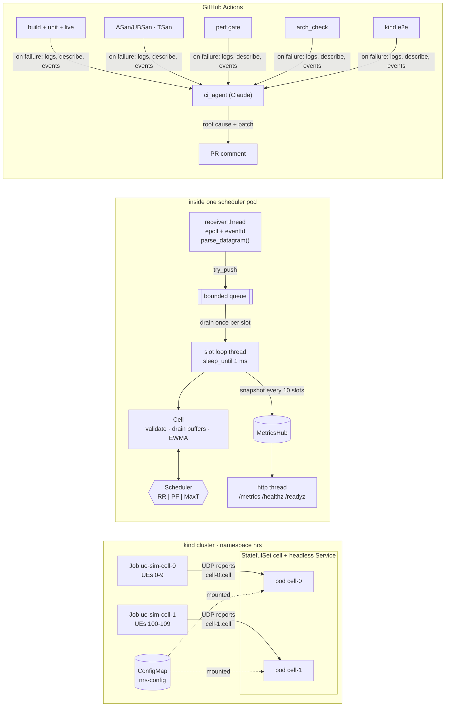

# nr-mac-scheduler

A cloud-native **5G NR downlink MAC scheduler**: the part of a gNB's
Distributed Unit that decides, every 1 ms slot, which UEs get which radio
resources. It is packaged as a containerized network function on Kubernetes, with
an automated CI/CD pipeline and an LLM agent that diagnoses pipeline failures.

* **C++17 core:** round-robin, proportional-fair and max-throughput policies behind
  one interface. CQI to spectral efficiency per TS 38.214 Table 1. Epoll UDP
  receiver, 1 ms slot loop, Prometheus metrics, clean SIGTERM shutdown,
  deterministic offline replay.
* **Python UE simulator:** CQI models (static, random walk, fading) and traffic
  models (full buffer, Poisson bursty, periodic), with live UDP and trace modes.
* **Kubernetes:** one StatefulSet pod per cell behind a headless Service,
  restricted Pod Security, distroless non-root images, probes and limits.
* **CI:** unit + live tests, ASan/UBSan, TSan, a performance gate against a
  baseline, an architecture-conformance check, and kind end-to-end.
* **AI agent:** reads failed-run artifacts and the diff, then comments the likely
  root cause and a patch on the PR. It is scored against 12 injected bugs.

Read [docs/DESIGN.md](docs/DESIGN.md) for the RAN concepts, the design decisions and
the simplifications compared to real NR, and [docs/interface.md](docs/interface.md)
for the wire format, metrics and config.

## Architecture



## Running it

Everything builds and runs on Linux (Ubuntu 24.04). On Windows, use WSL2 or the
dev container in `.devcontainer/`.

```bash
# Phase 1: build, test, run
sudo apt-get install -y build-essential cmake ninja-build clang-format python3-venv
python3 -m venv .venv && . .venv/bin/activate && pip install -e ue_sim pytest pyyaml matplotlib
make build                       # cmake --preset release
make test                        # GoogleTest + pytest (simulator, live binary end-to-end)
make asan && make tsan           # sanitizer builds of the unit tests

./build/release/nr_mac_scheduler --config config/default.yaml &     # live mode
python -m ue_sim live --scenario mixed --ues 10 --duration 10
curl -s localhost:8080/metrics | grep -E '^nrs_(cell|jain|prb|slot)'
kill -TERM %1                    # clean shutdown

python -m ue_sim trace --scenario fading_full --ues 10 --slots 20000 --seed 1 --out t.csv
./build/release/nr_mac_scheduler --mode offline --policy pf --trace t.csv --slots 20000 --out kpi.json

make bench                       # every policy x scenario -> bench/out/{results.csv,results.md,*.png}

# Phase 2: containers + Kubernetes
make kind-up deploy e2e          # kind cluster, load images, apply k8s/, run tests/e2e
make arch-check                  # manifest policy, ConfigMap keys, schema, wire constants
make kind-down

# Phase 3: CI agent
python -m tools.ci_agent --artifacts <downloaded-ci-artifacts> --base origin/main   # needs ANTHROPIC_API_KEY
python -m tools.ci_agent.eval    # inject each bug in bugs/, score the agent -> docs/agent_eval.md
```

## Benchmark results

<!-- BENCH:BEGIN -->
*Placeholder: run `make bench` on Linux. The table from
`bench/out/results.md` and the plot `bench/out/throughput_vs_fairness.png`
go here, along with `bench/baseline.json` for the CI gate.*
<!-- BENCH:END -->

## CI agent evaluation

<!-- EVAL:BEGIN -->
*Placeholder: run `python -m tools.ci_agent.eval` with `ANTHROPIC_API_KEY` set on a
Linux machine with docker and kind. Results are written to
[docs/agent_eval.md](docs/agent_eval.md).*
<!-- EVAL:END -->

## How I used AI coding tools

This project was built in phases with Claude Code as a pair programmer. I
wrote the specification (domain model, rules, KPIs, test requirements, the
"never invent numbers" rule), and Claude Code proposed the plans and wrote the
code. Each step was followed by compiling with `-Werror` and running the tests.
Things worth noting:

* **Tests as the contract.** The scheduler invariants, the PF-vs-RR-vs-MaxT
  comparison and the parser rejection cases were written as tests first. Changes
  were only accepted once those tests ran and passed.
* **The AI was wrong and the tooling caught it.** Examples from this build:
  yaml-cpp 0.8.0 failed to compile on a newer GCC (switched to 0.9.0), CMake 4
  rejected an old dependency's minimum version, `-Wconversion`/`-Wshadow` flagged
  sloppy test code, and a test fake that aliased a mutable list produced false
  failures until it snapshotted its inputs.
* **The agent is evaluated like any other component.** Each injected bug is first
  confirmed to break the stage that should catch it, so the eval also tests the
  CI design. The agent is then scored on file and cause, and the score table is
  generated, not hand-written.
* I can explain every line. [docs/DESIGN.md](docs/DESIGN.md) records each decision
  and why.
